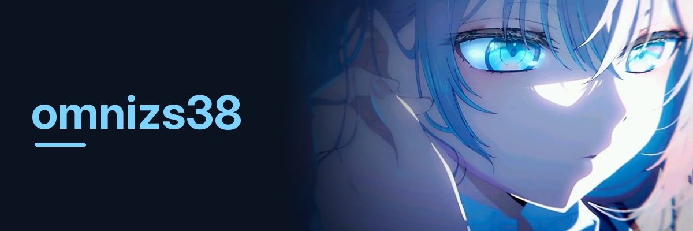

  

  <i>building small, fast things — quietly, like a good side character.</i>

---

## about

- low-level tooling in **Rust**, **Go** & **C++**
- lossless compression, binary formats, adaptive algorithms
- fast CLIs, native desktop apps, small dependency footprints
- deterministic > clever · validate > trust · measure > guess

## projects

- [**opengram**](https://github.com/omnizs38/opengram) — a cleaner, open-source take on Telegram Desktop.
- [**Osiris**](https://github.com/omnizs38/Osiris) — a C++ Counter-Strike 2 game hack for Windows and Linux, using Panorama UI.

## tools

  

  
<b>snapshot</b>

   

  

    
    
  

  
Cards are provided by a third-party service and may be temporarily unavailable.

---

  

  <b>Closed source asks you to trust. Open source lets you verify.</b> 
  <i>thanks for stopping by. 頑張って.</i>

