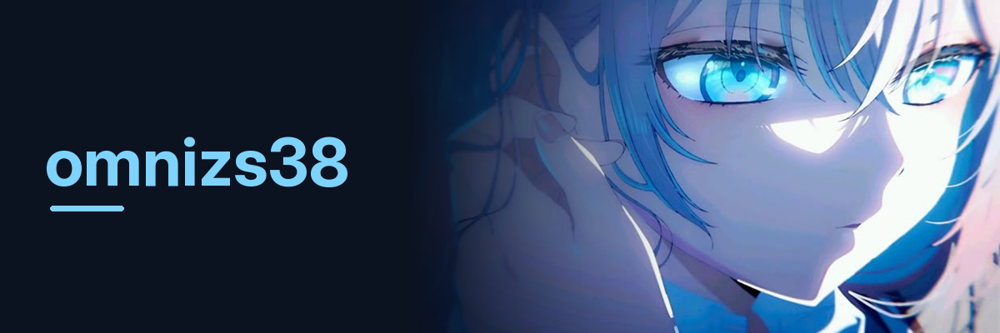

<p align="center">
  
</p>

<p align="center">
  <i>building things that feel simple, work fast, and stay out of the way.</i>
</p>

---

## about

- software development with **Rust**, **Go** & **C++**
- open-source contributor — working with existing codebases and upstream projects
- binary formats, compression, algorithms and performance-oriented tooling
- native desktop applications, lightweight CLIs and minimal dependencies
- interested in software architecture, developer experience and system design

**principles**

`deterministic > clever` · `validate > trust` · `measure > guess`

## open source

- **Cue** — contributor to an open-source project; 3 pull requests merged into the main branch.
- **OpenGram** — an experimental Telegram fork focused on a cleaner interface, parallel chats and productivity-oriented features.

## tools

<p>
  
</p>

<details>
  <summary><b>snapshot</b></summary>

  <br />

  <p align="center">
    
    
  </p>

  <p align="center"><sub>Statistics are provided by a third-party service and may be temporarily unavailable.</sub></p>
</details>

---

<p align="center">
  
</p>

<p align="center">
  <b>Closed source asks you to trust. Open source lets you verify.</b><br />
  <i>thanks for stopping by. 頑張って.</i>
</p>
```
